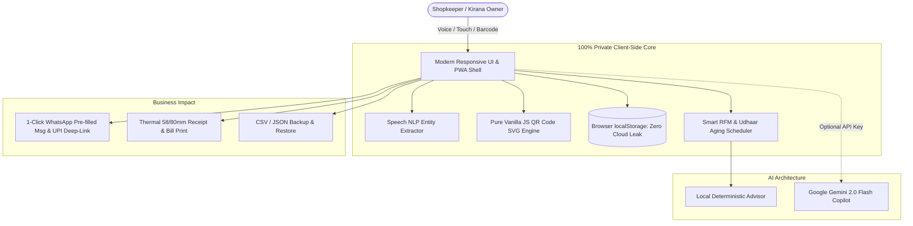

# 🏪 VyapaarAI — Next-Gen AI Growth Assistant & Voice Khatabook

<p align="center">
  
</p>

<p align="center">
  <b>"Your next sale starts with your next smart action."</b><br>
  <i>Empowering 63 Million+ Indian MSMEs with Offline-First AI, Voice Khatabook, Smart Udhaar Recovery & Dynamic UPI Payments.</i>
</p>

<p align="center">
  
  
  
  
  
  
</p>

---

## 🎯 The Problem & Ground Reality

In India, over **63 million micro, small, and medium enterprises (MSMEs)** form the backbone of the retail economy. The typical *Kirana* (neighborhood grocery store) owner faces three existential challenges daily:

1. **The Cashflow Trap (Uncollected Udhaar):** Over **₹3.5 Lakh Crore ($42 Billion)** is locked in informal consumer credit. Shopkeepers record credit in paper notebooks (*Bahi Khata*), rarely realizing which regular customer has stopped visiting or whose balance is critically overdue.
2. **Typing Friction on Counter:** Serving 5 to 10 customers simultaneously during rush hour makes typing amounts, categories, and customer names on a mobile screen virtually impossible.
3. **Data Privacy & Cloud Dependency:** Most shopkeepers are hesitant to upload their proprietary ledger and customer lists to cloud databases that sell their data or introduce recurring subscriptions.

---

## 💡 The Solution: VyapaarAI

**VyapaarAI** transforms a local merchant's mobile or desktop browser into an intelligent, private, and offline-first FinTech OS. 

### 🚀 Key Innovations & "Wow" Factors:

* **🎙️ "Bol Kar Khata Likho" (Voice Khatabook):**
  * Built-in natural language speech parser supporting Hindi, Hinglish, and English.
  * Say: *"Ramesh ko 450 rupaye ka doodh udhaar"* or *"Sunita 1200 snacks paid cash"* — extracts Customer, Amount, Category, and Payment Status with **1-tap confirmation**!
* **🧠 Dual-Engine AI Architecture:**
  * **Engine 1 (Offline Heuristics):** Runs 100% client-side with zero network calls. Computes RFM customer segments, Udhaar aging schedules, and category demand dips.
  * **Engine 2 (Google Gemini Flash Copilot):** Bring-Your-Own-Key integration for conversational business strategy, festive campaign drafting, and customer retention insights.
* **📲 Dynamic Bharat UPI QR Generator:**
  * Embeds an instant, scannable UPI QR code (`upi://pay?...`) generated client-side in pure SVG for any unpaid bill or customer balance. Customers scan with GPay, PhonePe, or Paytm and pay on the spot!
* **🧾 Thermal Bill & GST Invoice Generator:**
  * 1-click printable receipt formatted for 58mm/80mm thermal receipt printers or standard A4/PDF download with embedded UPI QR.
* **💬 Intelligent WhatsApp Campaign & Recovery Writer:**
  * Generates personalized polite win-back, festive offer, and payment reminder messages with deep-linked UPI payment links in English and Hinglish.
* **🌐 Multilingual Accessibility:**
  * 1-click switcher between **English**, **Hinglish**, and **हिन्दी (Hindi)**.
* **📱 True Progressive Web App (PWA):**
  * Fully installable on Android, iOS, Windows, and Mac. Service worker caches all assets for complete offline resilience.

---

## 🏗️ Architecture & Data Flow



---

## 📊 Feature Comparison: Why VyapaarAI Wins

| Feature | Traditional Khata / Registers | Khatabook / OkCredit | **VyapaarAI (Our Solution)** |
| :--- | :---: | :---: | :---: |
| **Voice Entry (Hindi / Hinglish)** | ❌ No | ❌ No | **✅ Yes ("Bol Kar Khata")** |
| **100% Offline Capability** | ✅ Yes (Paper) | ❌ Needs Internet | **✅ Yes (Service Worker PWA)** |
| **Data Privacy & Zero Cloud Leak** | ⚠️ Can be lost/burned | ❌ Stored on third-party servers | **✅ 100% Client-Side Private** |
| **Dual-Engine AI Copilot** | ❌ None | ❌ None | **✅ Gemini 2.0 + Local Heuristics** |
| **Dynamic UPI Payment QR** | ❌ None | ⚠️ Static / Fee-based | **✅ Instant Dynamic SVG QR** |
| **Thermal Bill & Invoice Printing** | ❌ None | ⚠️ Complex setup | **✅ 1-Click Native Print** |
| **Cost & Subscription** | Low | High / Upselling loans | **✅ 100% Free & Open Source (MIT)** |

---

## ⚡ Quickstart & How to Run

### Option 1: Zero Install (Direct Open)
1. Download or clone this repository.
2. Double-click **`index.html`** in any browser (Chrome, Edge, Safari, Brave, Firefox).
3. That's it! No `npm install`, no servers, no API key required to start.

### Option 2: Run with Local Server & PWA Testing
```bash
# Clone the repository
git clone https://github.com/your-username/VyapaarAI.git
cd VyapaarAI

# Run automated smoke & feature tests
npm test

# Launch local server
npm start
```

---

## 🧪 Testing & Reliability

VyapaarAI comes with a comprehensive automated test suite verifying both backward compatibility and newly introduced AI capabilities:

```bash
$ node smoke-test.js
--- Running Baseline Smoke Tests ---
--- Running Enhanced AI & FinTech Feature Tests ---
====================================
ALL SMOKE & INTEGRATION TESTS PASSED: 39
====================================
```

### Verified Test Cases:
* ✅ All 6 core screens render correctly in both demo and empty states.
* ✅ Multi-language dictionary localization (English, Hinglish, Hindi).
* ✅ Voice NLP parser accurately identifies Amount, Category, Customer, and Udhaar/Paid status from speech.
* ✅ Pure SVG Bharat UPI QR code generator produces valid SVG matrices with `<rect>` modules.
* ✅ Udhaar aging scheduler and churn risk scoring.
* ✅ Data backup, JSON export, and sales CSV generator.

---

## 👥 Hackathon Track & Originality Declaration

* **Hackathon Track:** Entrepreneurship & Local Business / FinTech & Retail AI.
* **Originality Declaration:** Built with genuine empathy for India's 63M+ shopkeepers. All sample data is fictional. Zero personal or external customer data is transmitted.

---

<p align="center">
  <b>Built for Bharat 🇮🇳 | Made with ❤️ for Indian MSMEs</b>
</p>
